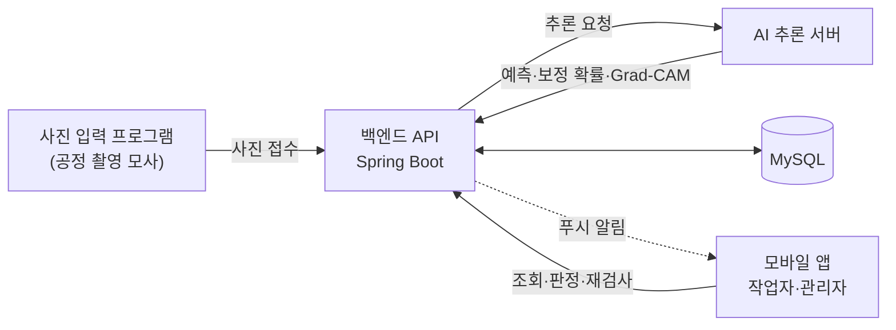

# AI 기반 자동차 부품 품질검사 플랫폼

캡스톤디자인 2026-2 · 3조 김이홍

공정에서 촬영한 부품 사진을 AI가 분석하고, 기준을 만족한 건만 자동 통과시키고 나머지는 작업자가 앱에서 확인해 최종 판정하는 시스템입니다.

## 팀 구성

| 파트 | 담당 | 폴더 | 하는 일 |
|---|---|---|---|
| 백엔드 API | 이승규 | [`backend/`](backend/) | 사진 접수, AI 호출, 자동 통과 판정, 검사 기록·작업자 확인·재검사, 관리자 정책, 알림 |
| AI | 김도현 | [`ai/`](ai/) | 불량 분류 모델, 확률 보정, Grad-CAM, 추론 서버, 정책 검증 자료 |
| 모바일 앱 | 홍승인 | [`mobile/`](mobile/) | 작업자·관리자 앱 (모니터링, 상세, 판정, 재검사, 정책 화면) |
| DB | 김남균 | [`db/`](db/) | 저장 구조 설계, 제약·조회 검증 |

## 시스템 구성



검사 흐름

1. 입력 프로그램이 사진을 올리면 백엔드가 원본을 저장하고 바로 접수 번호를 돌려줍니다 (분석은 비동기)
2. 백엔드가 AI 서버에 분석을 요청하고, 응답과 활성 정책으로 **자동 통과(AUTO_PASS)** 또는 **작업자 확인(REVIEW)** 을 정합니다
3. REVIEW·분석 실패 건은 앱에 알림이 가고, 작업자가 사진과 판단 근거(Grad-CAM)를 보고 PASS·FAIL을 확정합니다
4. 분석에 실패한 건은 같은 사진으로 재검사합니다 (원래 기록은 그대로 두고 새 검사 생성)

자세한 규칙은 [docs/백엔드_API계약_v4.md](docs/백엔드_API계약_v4.md)를 기준으로 합니다.

## 폴더 구조

```
.
├── backend/   백엔드 API (Spring Boot 3.5, Java 17, MySQL 8.4) + 개발용 Mock AI
├── ai/        AI 추론 서버·모델
├── mobile/    모바일 앱 (React Native, Expo)
├── db/        DB 설계 SQL·ERD
└── docs/      공통 기준 문서 (API 계약 등)
```

각 폴더의 README에 실행 방법을 적습니다.

## 통합 실행 순서

개발용은 PC 한 대에서 Mock AI로, 실제 연결은 Tailscale로 Mac(백엔드)·DGX(AI)·iPhone(앱)을 묶어 실행합니다.

| 순서 | 무엇 | 방법 |
|---|---|---|
| 1 | MySQL | `backend/`에서 `docker compose up -d` (기존 `inspection-mysql` 컨테이너가 있으면 `docker start inspection-mysql`) |
| 2 | AI 서버 | 실제 서버는 [`ai/`](ai/) 안내 (DGX, 포트 8771), 없으면 [`backend/mock-ai`](backend/mock-ai/) (포트 8090) |
| 3 | 백엔드 | `backend/`에서 `./gradlew bootRun` (포트 8080, Swagger: `/swagger-ui.html`). 실제 AI는 `APP_AI_BASEURL`·`PUBLIC_BASE_URL` 지정 |
| 4 | 앱 | [`mobile/`](mobile/) 안내. 백엔드 주소는 `localhost`가 아니라 PC의 Tailscale 또는 내부 IP |

명령과 테스트 계정은 [backend/README.md](backend/README.md)에 있습니다.

## 진행 현황

| 파트 | 현재 상태 (11/05) |
|---|---|
| 백엔드 | 인증, 사진 접수(비동기), AI 연동·판정, 검사 상세·이력, 모니터링, 작업자 확인, 재검사, 관리자 모델·정책 API, 기기 토큰·Expo 푸시 발송 구현. DB V5 무결성 제약 적용. 테스트 86건, GitHub Actions CI. 실제 AI 연결 시험 완료(11/04) |
| AI | e02 모델(`door-swin-tiny-e02-28a2dd1cb40b-dev`) 추론 서버 공개본 업로드(PR #1). DGX에서 실행 중이며 백엔드와 실제 연결 시험 완료(11/04). 보정기·AUTO_PASS 기준은 데이터 독립성 확인 전이라 미제공 → 분석 결과는 모두 작업자 확인(REVIEW). 자세한 내용은 [ai/README.md](ai/README.md), [ai/VALIDATION.md](ai/VALIDATION.md) |
| 모바일 앱 | Expo 앱 (PR #2, #4). **로그인·토큰 재발급과 모니터링은 실제 서버 연결**(서버 주소는 `.env.local`의 `EXPO_PUBLIC_API_URL`). 이력·상세·판정·통계·정책 화면은 아직 Mock 데이터이고 계약 v4 연동 코드(`src/api/backendV4/`)를 화면에 붙이는 중. 푸시 토큰 등록은 미구현 |
| DB | 설계 자료 업로드(PR #3): V1~V5 통합 스키마(비교용), 저장 흐름 예시, 제약 위반 테스트 28건, 무결성 점검 12개, ERD, 명세서 4.3 개정 문안(FR-DB-05 NO_ACTIVATION 반영). 실제 서버 스키마는 백엔드 Flyway 마이그레이션 기준. 자세한 내용은 [db/README.md](db/README.md) |

연결 시험 결과는 [docs/통합_점검표.md](docs/통합_점검표.md)에 기록합니다.

각 파트 담당자가 직접 갱신합니다.

## 협업 규칙

- **main에 직접 push하지 않습니다.** 파트별 브랜치에서 작업하고 Pull Request로 합칩니다
  - 브랜치 이름: `backend/작업명`, `ai/작업명`, `mobile/작업명`, `db/작업명`
- 다른 파트 폴더를 고쳐야 하면 그 파트 담당자에게 먼저 알리고 PR 리뷰를 받습니다
- API 형식·상태 값·판정 규칙을 바꿀 때는 `docs/`의 계약 문서를 먼저 고칩니다
- 커밋 메시지는 한국어로 짧게, 한 커밋에는 한 가지 변경만
- **공개 저장소입니다.** 비밀번호·토큰·`.env`, 실제 공정 사진, 개인정보, 큰 모델 파일은 올리지 않습니다
