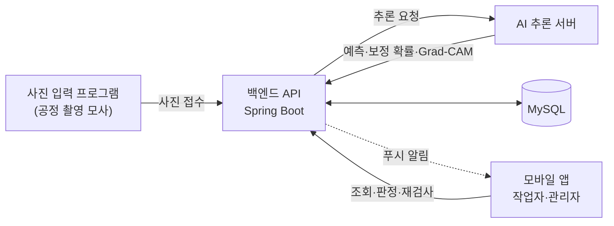

# AI 기반 자동차 부품 품질검사 플랫폼

캡스톤디자인 2026-2 · 3조 김이홍

공정에서 촬영한 부품 사진을 AI가 분석하고, 기준을 만족한 건만 자동 통과시키고 나머지는 작업자가 앱에서 확인해 최종 판정하는 시스템입니다.

## 팀 구성

| 파트 | 담당 | 폴더 | 하는 일 |
|---|---|---|---|
| 백엔드 API | 이승규 | [`backend/`](backend/) | 사진 접수, AI 호출, 자동 통과 판정, 검사 기록·작업자 확인·재검사, 관리자 정책, 알림 |
| AI | 김도현 | [`ai/`](ai/) | 불량 분류 모델, 확률 보정, Grad-CAM, 추론 서버, 정책 검증 자료 |
| 모바일 앱 | 홍승인 | [`mobile/`](mobile/) | 작업자·관리자 앱 (모니터링, 상세, 판정, 재검사, 정책 화면) |
| DB | 김남균 | [`db/`](db/) | 저장 구조 설계, 제약·조회 검증 |

## 시스템 구성



검사 흐름

1. 입력 프로그램이 사진을 올리면 백엔드가 원본을 저장하고 바로 접수 번호를 돌려줍니다 (분석은 비동기)
2. 백엔드가 AI 서버에 분석을 요청하고, 응답과 활성 정책으로 **자동 통과(AUTO_PASS)** 또는 **작업자 확인(REVIEW)** 을 정합니다
3. REVIEW·분석 실패 건은 앱에 알림이 가고, 작업자가 사진과 판단 근거(Grad-CAM)를 보고 PASS·FAIL을 확정합니다
4. 분석에 실패한 건은 같은 사진으로 재검사합니다 (원래 기록은 그대로 두고 새 검사 생성)

자세한 규칙은 [docs/백엔드_API계약_v4.md](docs/백엔드_API계약_v4.md)를 기준으로 합니다.

## 폴더 구조

```
.
├── backend/   백엔드 API (Spring Boot 3.5, Java 17, MySQL 8.4) + 개발용 Mock AI
├── ai/        AI 추론 서버·모델
├── mobile/    모바일 앱 (React Native, Expo)
├── db/        DB 설계 SQL·ERD
└── docs/      공통 기준 문서 (API 계약 등)
```

각 폴더의 README에 실행 방법을 적습니다.

## 통합 실행 순서

같은 와이파이에서 개발 PC 한 대로 띄우는 기준입니다.

| 순서 | 무엇 | 방법 |
|---|---|---|
| 1 | MySQL | `backend/`에서 `docker compose up -d` |
| 2 | AI 서버 | 실제 서버는 [`ai/`](ai/) 안내, 없으면 [`backend/mock-ai`](backend/mock-ai/) (포트 8090) |
| 3 | 백엔드 | `backend/`에서 `./gradlew bootRun` (포트 8080, Swagger: `/swagger-ui.html`) |
| 4 | 앱 | [`mobile/`](mobile/) 안내. 백엔드 주소는 `localhost`가 아니라 PC의 내부 IP |

명령과 테스트 계정은 [backend/README.md](backend/README.md)에 있습니다.

## 진행 현황

| 파트 | 현재 상태 |
|---|---|
| 백엔드 | 인증, 사진 접수(비동기), AI 연동·판정, 검사 상세·이력, 모니터링, 작업자 확인, 재검사 구현. 관리자 정책 API·푸시 알림 진행 예정 |
| AI | |
| 모바일 앱 | |
| DB | |

각 파트 담당자가 직접 갱신합니다.

## 협업 규칙

- **main에 직접 push하지 않습니다.** 파트별 브랜치에서 작업하고 Pull Request로 합칩니다
  - 브랜치 이름: `backend/작업명`, `ai/작업명`, `mobile/작업명`, `db/작업명`
- 다른 파트 폴더를 고쳐야 하면 그 파트 담당자에게 먼저 알리고 PR 리뷰를 받습니다
- API 형식·상태 값·판정 규칙을 바꿀 때는 `docs/`의 계약 문서를 먼저 고칩니다
- 커밋 메시지는 한국어로 짧게, 한 커밋에는 한 가지 변경만
- **공개 저장소입니다.** 비밀번호·토큰·`.env`, 실제 공정 사진, 개인정보, 큰 모델 파일은 올리지 않습니다
