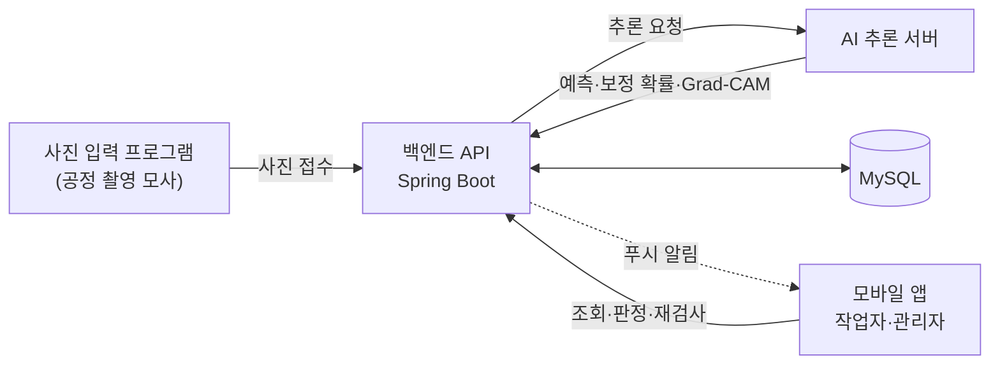

# AI 기반 자동차 부품 품질검사 플랫폼

캡스톤디자인 2026-2 · 3조 김이홍

공정에서 촬영한 부품 사진을 AI가 분석하고, 기준을 만족한 건만 자동 통과시키고 나머지는 작업자가 앱에서 확인해 최종 판정하는 시스템입니다.

## 팀 구성

| 파트 | 담당 | 폴더 | 하는 일 |
|---|---|---|---|
| 백엔드 API | 이승규 | [`backend/`](backend/) | 사진 접수, AI 호출, 자동 통과 판정, 검사 기록·작업자 확인·재검사, 관리자 정책, 알림 |
| AI | 김도현 | [`ai/`](ai/) | 불량 분류 모델, 확률 보정, Grad-CAM, 추론 서버, 정책 검증 자료 |
| 모바일 앱 | 11/25 최종 모바일 통합 #68 main 병합. 실제 로그인·도어/프레임/카울커버 모니터링·검사 상세/사진 확대·작업자 판정/재확인/일괄 FAIL·판정 확인 요청·관리자 세 부품 정책·날짜별 이력 제공. 앱 실행 중 폴링 배너 사용, iOS 백그라운드/종료 원격 푸시는 미구현. 로그인 화면 Mock 진입 제거, 기존 통계는 Mock. 병합본 타입 CI 성공 및 전체 회귀 285/285 통과. 최신 iPhone·승인된 실서버 쓰기 재시험은 별도. [실행·시연 안내](mobile/README.md) |
| DB | 김남균 | [`db/`](db/) | 저장 구조 설계, 제약·조회 검증 |

## 시스템 구성



검사 흐름

1. 입력 프로그램이 사진을 올리면 백엔드가 원본을 저장하고 바로 접수 번호를 돌려줍니다 (분석은 비동기)
2. 백엔드가 AI 서버에 분석을 요청하고, 응답과 활성 정책으로 **자동 통과(AUTO_PASS)** 또는 **작업자 확인(REVIEW)** 을 정합니다. 정책에서 **자동 불량(AUTO_FAIL)** 을 켠 경우에만 불량 기준 이상인 DEFECT 예측이 자동 FAIL이 됩니다 (기본 꺼짐)
3. REVIEW 건은 작업자가 사진과 판단 근거(Grad-CAM)를 보고 PASS·FAIL을 확정합니다 (FAIL은 최대 50건 일괄 확정 가능). 시스템 판정(AUTO_PASS·AUTO_FAIL)이 틀렸다고 보이면 작업자가 확인 요청을 올리고 관리자가 유지·정정합니다. REVIEW·분석 실패 알림은 백엔드 발송까지 구현됐고 앱 푸시 등록·수신은 미구현입니다 (자동 불량 알림은 앱 폴링 내부 알림)
4. 분석에 실패한 건은 같은 사진으로 재검사하거나, AI 없이 작업자가 원본을 보고 판정하는 **수동 판정**으로 전환합니다 (원래 기록은 그대로 두고 새 검사 생성, 둘 중 하나만)

자세한 규칙은 [docs/백엔드_API계약_v4.md](docs/백엔드_API계약_v4.md)를 기준으로 합니다.

## 폴더 구조

```
.
├── backend/   백엔드 API (Spring Boot 3.5, Java 17, MySQL 8.4) + 개발용 Mock AI
├── ai/        AI 추론 서버·모델
├── mobile/    모바일 앱 (React Native, Expo)
├── db/        DB 설계 SQL·ERD
└── docs/      공통 기준 문서 (API 계약 등)
```

각 폴더의 README에 실행 방법을 적습니다.

## 통합 실행 순서

개발용은 PC 한 대에서 Mock AI로, 실제 연결은 Tailscale로 Mac(백엔드)·DGX(AI)·iPhone(앱)을 묶어 실행합니다.

| 순서 | 무엇 | 방법 |
|---|---|---|
| 1 | MySQL | `backend/`에서 `docker compose up -d` (기존 `inspection-mysql` 컨테이너가 있으면 `docker start inspection-mysql`) |
| 2 | AI 서버 | 실제 서버는 [`ai/`](ai/) 안내 (DGX, 포트 8771), 없으면 [`backend/mock-ai`](backend/mock-ai/) (포트 8090) |
| 3 | 백엔드 | `backend/`에서 `./gradlew bootRun` (포트 8080, Swagger: `/swagger-ui.html`). 실제 AI는 `APP_AI_BASEURL`·`PUBLIC_BASE_URL` 지정 |
| 4 | 앱 | [`mobile/`](mobile/) 안내. 백엔드 주소는 `localhost`가 아니라 PC의 Tailscale 또는 내부 IP |

명령과 테스트 계정은 [backend/README.md](backend/README.md)에 있습니다.

## 진행 현황

| 파트 | 현재 상태 (11/25) |
|---|---|
| 백엔드 | 인증(로그인 5회 실패 잠금·관리자 해제·토큰 회전)·사진 접수(비동기)·AI 연동·검사 상세/이력·모니터링·작업자 판정·재검사·**수동 판정**(V6, [결정안](docs/수동판정_결정안.md) B안, 계약 6.10)·관리자 정책·기기 토큰/Expo 푸시 발송 구현. **부품별 AI 서버**(도어 8771·프레임 8774·카울커버 8778, `APP_AI_PARTBASEURLS_*`). DB V14(V7 검사항목 `UNIFIED` 통일 11/17, V8·V9 AUTO_PASS 표본 재확인 11/18, V10 재확인 CHECK 보강, V11 일괄 FAIL `batch_id`, V12 판정 확인 요청, V13·V14 자동 불량). 11/18 추가: CSV 내보내기·AI-작업자 불일치 필터·후보 기준치 비교·표본 재확인 공동시험 기록(계약 6.9.1·6.11). **11/25 병합: 확인 필요 목록 정렬·필터(#49), 일괄 FAIL(#50), 판정 확인 요청·정정(#51), 자동 불량 AUTO_FAIL(#52), 날짜별 이력·기준 상세(#53), 계약 v4 제안 문서(#48)**. 테스트 205건(건너뜀 2, 실패 0), Backend·Mobile CI. AI 읽기 타임아웃 시연용 20초, 동시 호출 1개. 통계 API는 합의본상 범위 제외(앱 통계 화면은 시연용 Mock) |
| AI | 도어 e02(8771)는 보정기 없어 분석 완료 건 REVIEW. **프레임(8774, 시연 기준 3.67%)·카울커버(8778, 1.63%, GPU) 통합 모델은 보정기가 있어 실서버 AUTO_PASS** 확인(11/11, INS-000103·106·115). 불량은 LayerCAM. 시연 기준은 평가 사진에 사후 적용한 값으로 운영 기준 아님. 자세한 내용은 [ai/README.md](ai/README.md), [ai/VALIDATION.md](ai/VALIDATION.md) |
| 모바일 앱 | 로그인·모니터링(DOOR·FRAME 공정 선택, 관측 시각)·상세·판정·재검사·이력 실서버 연동(PR #9·#14·#15 병합). 11/11 iPhone 실서버에서 판정·재검사(A8·A10), 전체 흐름(E3, 푸시 제외), 부품별 화면·LayerCAM(F5) 통과. 수동 판정 화면(PR #18) M1 실서버 통과. 도어 30→35% Mock 정책 시연 화면(PR #12)은 백업용. 통계 화면은 Mock, 푸시 토큰 등록은 미구현. 11/24 공동시험에 쓴 신규 기능 화면(#54~#59: 우선 검토 정렬·일괄 FAIL·판정 확인 요청·AUTO_FAIL 관리자 기준·날짜별 이력)은 Draft이며 백엔드 병합이 끝나 순서대로 Ready 전환 예정 (#43 표본 재확인 화면은 보류) |
| DB | V1~V5 비교용 스키마·저장 흐름·제약 위반 시험 28건·무결성 점검(11/11 수동 판정 규칙 추가로 14개)·ERD. 11/11 실제 DB 무결성 14개 모두 위반 0건(김남균 확인), V6 제약 확인·명세서 4.3에 수동 판정 반영(PR #22). 실제 스키마는 백엔드 Flyway(V14) 기준. 11/24 시험 DB 무결성 점검 이상 없음 확인, V10~V14 반영·일괄 FAIL·판정 확인 요청 점검 추가는 PR #61 리뷰 대기. 검사항목 코드는 세 부품 모두 `UNIFIED`로 확정(TBD-04, 11/17 V7). 자세한 내용은 [db/README.md](db/README.md) |

연결 시험 결과는 [docs/통합_점검표.md](docs/통합_점검표.md)에 기록합니다. 시연 순서와 장애 대비는 [docs/시연_절차서.md](docs/시연_절차서.md)(초안)를 따릅니다.

- 11/11 병합: #12(도어 30→35% Mock 정책 시연, 시연 장애 시 백업), #18(수동 판정 화면, M1 통과), #19(카울커버 GPU 전환 기록). 열린 PR 없음. 시연 B 구간은 실제 AI 카울커버로 결정
- 11/11 공동 시험: 점검표 60개 항목 중 통과 44·조건부 통과 7. 남은 보류는 A7·F9(리허설 때), A12~A14(앱 푸시 미구현), B6·P0(도어 e02 보정기·0맵)
- 11/12: 도어 Mock 시연 기준을 AI 내부 평가 값(기본 0.92%, 조정 하한 0.84%)으로 백엔드에 반영(시드 V6_2, 테스트 109건). 실제 e02는 REVIEW 유지 확인(INS-000120). 점검표에 11/13 시험 항목 F11(앱 정책 화면, PR #20)·F12(앱 내부 배너, PR #21) 추가 → 62개 항목
- 11/13: 홍승인과 공동 시험 — 앱 관리자 정책 화면으로 카울커버 기준 적용·복귀(F11), 앱 내부 새 REVIEW 배너(F12), 이미지 주소 만료 후 재조회(A7), WORKER 정책 API 403(P6) 통과, 무결성 14개 0건(INS-000121~124)
- 11/17: 도어 검사항목 `UNIFIED` 통일(V7, TBD-04 확정)·도어 e02 시연 보정기·정책(V7_1). 보정기를 켠 e02 서버(8785)로 0.84% REVIEW → 0.92% AUTO_PASS 실서버 통과(F13, INS-000128·129). 서버·AI 리허설 INS-000130~138, 무결성 0건
- 11/18 백엔드: CSV 내보내기(#30)·불일치 필터(#32)·후보 기준치 비교(#35)·AUTO_PASS 표본 재확인(#36, V8) 병합. 김도현·홍승인과 재확인 공동시험 방식 합의(100·30·10% 수집, 50·30·10% 가상 비교, 관리자 확인함, 화면 체류 시간) → V9(#42, 확인 대기)

- 11/19 표본 재확인 공동시험 1차 (세 부품 수집·요약 확인), 11/20 V10(재확인 CHECK NULL 구멍 보강, #47·#46)
- 11/23 계약 v4 제안(REVIEW 개선·판정 확인 요청·자동 불량·날짜별 이력)을 #48로 올리고 김도현·홍승인과 범위 합의 (AUTO_FAIL 알림은 원격 푸시 대신 앱 폴링 내부 알림, 저장·조회 시각은 서울 기준)
- 11/24 **자동 판정 관리자·작업자 공동시험**: 서버·DB·앱(iPhone)·AI를 묶어 신규 기능을 실서버로 시험 (점검표 통과 25·실패 0·보류 4: A05·B07·C03·C04). 작업자에게 다른 작업자의 확인 요청 사유·이름을 모두 보여 주는 것은 설계로 확정 (미숙련자 판정 재확인용). 확인 필요 일괄 화면의 정렬·필터는 후속 개선
- 11/25 백엔드 PR #48~#53 병합. 열린 PR: 모바일 #54~#59 (Draft, 백엔드 병합 순서에 맞춰 Ready 예정), #43 (보류), #27, #61(DB)

각 파트 담당자가 직접 갱신합니다.

## 협업 규칙

- **main에 직접 push하지 않습니다.** 파트별 브랜치에서 작업하고 Pull Request로 합칩니다
  - 브랜치 이름: `backend/작업명`, `ai/작업명`, `mobile/작업명`, `db/작업명`
- 다른 파트 폴더를 고쳐야 하면 그 파트 담당자에게 먼저 알리고 PR 리뷰를 받습니다
- API 형식·상태 값·판정 규칙을 바꿀 때는 `docs/`의 계약 문서를 먼저 고칩니다
- 커밋 메시지는 한국어로 짧게, 한 커밋에는 한 가지 변경만
- **공개 저장소입니다.** 비밀번호·토큰·`.env`, 실제 공정 사진, 개인정보, 큰 모델 파일은 올리지 않습니다
